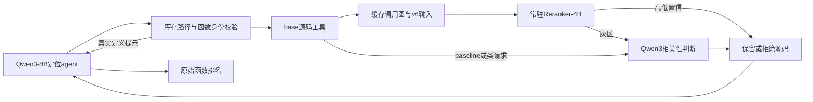

# 工程修复v2：最终总览

2026-11-10；20题×2臂实际完成。主模型保持Qwen3-8B，继续使用原训练版Qwen3-Reranker-4B，没有重新训练。GPU2、3已正常释放，其他任务未动。

**本轮确认改善了两类通用工具链错误，并将4B改为一次加载、逐题复用缓存。17道既有函数题中，两臂均由上轮10/17变为12/17；未观察到4B额外增加命中。hybrid在线平均耗时从上轮93.54秒变为60.84秒，CPU准备成本另外披露。**

本报告为解释入口；[逐题审阅](逐题审阅.md)和[独立逐题CSV](逐题独立核验.csv)保留全部20题。自动总表、机器生成证据和独立审计JSON作为重算记录，不覆盖本报告。

## 定位表现

| 范围／方法 | Hit@1 | Hit@3 | Hit@5 | Macro-Recall@5 | 全部目标覆盖@5 |
|---|---:|---:|---:|---:|---:|
| v1 baseline，既有函数17题 | 9/17（52.94%） | 10/17（58.82%） | 10/17（58.82%） | 55.88% | 9/17（52.94%） |
| v1 hybrid，既有函数17题 | 9/17（52.94%） | 10/17（58.82%） | 10/17（58.82%） | 55.88% | 9/17（52.94%） |
| v2 baseline，既有函数17题 | 10/17（58.82%） | 12/17（70.59%） | 12/17（70.59%） | 67.65% | 11/17（64.71%） |
| v2 hybrid，既有函数17题 | 10/17（58.82%） | 12/17（70.59%） | 12/17（70.59%） | 67.65% | 11/17（64.71%） |
| v2 baseline，原20题口径含新增目标 | 12/20 | 14/20 | 14/20（70.00%） | 65.00% | 12/20（60.00%） |
| v2 hybrid_safe，原20题口径含新增目标 | 12/20 | 14/20 | 14/20（70.00%） | 65.00% | 12/20（60.00%） |

实际文件菜单由baseline生成后共享：Hit@1 14/20（70%），Hit@3/@5均16/20（80%）；v1对应13/20、15/20、15/20。文件指标是规范化后实际消费的候选菜单，原始文件回复同时保留。函数最终输出保持原文，严格按path::qualified_name及原始前5槽评分，类项、无效身份和重复项不压缩。

与v1同题相比，两臂均新增命中2题、退化0题；17题Hit@5差值+11.76pp，精确McNemar p=0.5。v2两臂互比：共同命中12、共同未命中5，不一致对0，p=1.0。70.59%的Wilson 95%CI为46.87%–86.72%；保守配对差值区间仍宽至±22.72pp，不能认证非劣效或等效。区间与检验仅描述本开发小样本，未按仓库聚类修正，不用于总体泛化。

17题包含11题完全覆盖、1题部分覆盖、5题完全未命中。部分覆盖题sphinx-8273命中ManualPageBuilder.write，遗漏同文件的setup；Hit@5仅表示至少一个参考目标进入前5。本轮没有生成修复补丁或执行修复测试。

原20题还包含3道仅有新增函数目标的题（sympy-12171、django-13220、sympy-15308），保留原记录并单列，17题指标不把它们放入分母。v1原口径baseline11/20、hybrid12/20；v2均14/20。其中django-13220新增方法名称的变化不作为4B保护既有源码的证据。

## 已核验的工程改善

| 题目 | v1两臂 | v2两臂 | 实际证据 |
|---|---|---|---|
| django__django-11583 | 将模块函数当作StatReloader方法，未读到gold | 全局iter_modules_and_files进Top1 | 先给BaseReloader.watched_files的真实定义帮助，再于step4读取模块级目标；source-0003实际进入两臂请求正文 |
| matplotlib__matplotlib-24149 | 漏lib/，文件菜单空、所有读取失败 | 真正路径下Axes._convert_dx进Top3 | 唯一库存前缀映射后，模型反射回复和最终函数回复都使用lib/；source-0001实际送达两臂 |

通用规则中没有硬编码这两个issue或gold函数：只解析唯一的库存路径前缀、返回同名真实定义、显示准确的base源码身份。函数所属关系不自动改选，最终函数预测不补路径、不补类名。Matplotlib初始5个文件路径由规则规范化后，反射阶段模型本身已输出真实lib/路径；完整原始响应可查。

这些是符合预期机制的实际观察。v2同时改变了身份反馈、源码身份头与缓存架构，主模型仍有单次推理轨迹差异；不能将全部11.76pp变化唯一归因于其中某条改动，也不能据此声称4B训练带来了新增命中。



## 时间与token：在线和准备分开

下表hybrid可比量均补计同题共享文件阶段；实际新增调用账不重复计算文件阶段。

| 指标（20题同题范围） | v2 baseline | v2 hybrid |
|---|---:|---:|
| 可比全流程主模型token | 3,019,824 | 2,561,234（−15.19%） |
| 可比主模型输入token | 3,006,161 | 2,547,321 |
| 可比主模型输出token | 13,663 | 13,913 |
| 主模型剪枝相关token | 294,210 | 141,197（−52.01%） |
| 本地4B实际输入token | 0 | 130,008 |
| 可比整题平均时间 | 57.46秒 | 60.84秒（+5.89%） |
| 可比整题中位时间 | 59.75秒 | 61.07秒 |

hybrid实际新增主模型token为2,117,566，补计443,668个共享文件token后为2,561,234；本批实际两臂合计5,137,390个主模型token，另有4B输入130,008。全部是本地推理，付费API账单0美元；GPU／用电成本未计价。

v1 hybrid可比平均93.54秒，v2为60.84秒，观察到在线平均减少34.95%；v1平均比baseline慢54.89%，本轮慢5.89%。这是整个工程包及实际搜索轨迹的观测差异，不是单独控制初始化一个变量的因果估计。

准备与驻留代价另列：

- 本次CPU准备总墙钟483.45秒，其中逐题缓存准备与103条一致性检查合计414.80秒；这不是纯AST构建时间。
- 20份JSON缓存共508,433,873字节，约485MiB；复用已有base快照，没有复制模型权重。
- 4B构造阶段仅一次，记录4.98秒；该计时不含进程导入等全部服务启动成本。20题读取缓存／初始化CPU渲染器共27.42秒，中位1.39秒。
- 130次正式评分中位0.172秒、P95 0.426秒（最近秩定义）；另有3条点火前评分和一次8128 token合成显存检查，单列而不冒充正式题目。
- 控制器从等待资源到关闭总2420.67秒，约40.34分钟，包含90秒等卡、模型启动和两臂串行执行；CPU准备在此之前。不能将60.84秒表述成完整冷启动端到端时间。

新版baseline主模型token较v1增加26.65%，hybrid增加28.33%。新增的有效源码和反馈会增加开销，不能只宣传v2两臂之间15.19%的下降。baseline剪枝阶段只占其主模型token的9.74%；全流程下降还包括搜索等阶段的轨迹变化，不能全部解释为替换判断器的直接节省。

4B常驻约占第二张卡8.1GiB显存（观测8328MiB），期间为两臂保持同样的共卡配置；它没有成为第三张GPU。稀疏评分时保留显存是降低重复加载的代价。本轮结束后本次两种模型服务都已关闭，GPU2/3各约19MiB残留基础占用。

## 路由、安全及仍未解决的问题

130次正式4B评分：54次高分直留（41.54%）、69次灰区（53.08%）、7次低分直拒（5.38%）。实际进入4B的gold共12种身份、15次评分，均为高分直留。4B直接拒绝gold为0，所有来源中拒绝包含gold完整定义的源码块也为0；剩余未访问目标不能算作已证明安全。

7次直接拒绝未命中参考目标身份，并不能证明它们在语义／因果上都无关，不能据此报告剪枝precision=100%。本轮没有给E类噪声做新的独立定量定论。

共同完全漏定位的5题：

| 类别 | issue | 可观察原因 |
|---|---|---|
| gold文件未进菜单（4题） | sympy-12419 | 缺matexpr.py，停留在refine/doit/applyfunc；hybrid重复相同错误调用，提示没有保证模型采纳 |
| 同上 | sympy-13895 | 缺numbers.py，停留在Pow/Expr/simplify；相同_eval_power名字不等于Integer实现 |
| 同上 | sphinx-8627 | 停留在autodoc/importer，缺util/typing.py中的restify/stringify |
| 同上 | django-16820 | 选择Options/Index/命令层，缺operations/models.py的CreateModel.reduce |
| 文件在但目标函数未提取（1题） | sympy-13146 | operations.py已在菜单，仍未读到AssocOp._eval_evalf |

这些题的参考目标源码均未进入搜索上下文，没有观察到“读到gold后被4B剪掉”的失败。当前更明显的瓶颈是文件候选召回与函数探索／身份理解。提示真实定义只保证该定义存在，不保证它是正确继承实现或与issue相关；本轮仍有重复错误调用，不能称为彻底解决工具使用。

base身份无法匹配的原始Top5槽：baseline由v1的37/100变为26/100，hybrid由41/100变为33/100，仍包含类项、新增函数建议及错误限定名。全部40臂都至少读到并送达过一段源码，但“收到某段源码”仍不等于收到正确目标。12道命中的既有函数题均有实际目标源码送达证据。

## 验证、隔离和发布

模型保持Qwen/Qwen3-8B revision b968826d9c46dd6066d109eabc6255188de91218；4B仍为v6首轮1:2 epoch1原LoRA，温度2.9846201034621833、low0.12947567721292427/high0.9；未重训或调阈值。阈值仍基于旧val拟合，同val零误剪不构成独立安全验证。主模型2048输出、65536上下文、BF16 TP2、temperature0/seed0/n1、显式关闭thinking；两卡参数与v1相同。v6长输入及每方向16邻居不变。

24项CPU测试、真实bwrap只读socket通信和18项私有路径不可见检查均通过；缓存重建与v1全部103条实际4B输入逐字、SHA、邻居一致；4B底座16文件重新核验一致，3条点火前真实评分保持原路由。主模型684个请求均核验非思考与参数、usage可知，无输出截断；1106个源码送达事件对应实际请求正文和先前接受事件；275份完整源码返回块核验正文与身份头；130条正式评分逐项匹配常驻服务的序号、SHA、分差及token数。

原代码／输入保护哈希、v1的120项结果／上下文／事件、历史矩阵、封存test的stat均未变；推理进程无法看到gold、训练／验证记录或密钥；封存test内容未打开。原上游HEAD仍为86dacd7d18c1198ff20da64595b7f1222d93281e。

关停也实测通过：评分器正常exit0，主服务SIGTERM后按不变PID身份轮询，未再出现旧版argv/cwd退出竞态；没有强杀或操作他人进程。固定20题仍为18 train来源＋2 val来源，已用于调试，不构成新的独立泛化验证；本轮不扩到全300／265题。

修改前备份：[a2c7799](https://github.com/dantongwangwww/cosil_repro/commit/a2c779961bf925704181915759da09df34be07a3)。全部推理代码在点火前发布并核验：[d5e3d74](https://github.com/dantongwangwww/cosil_repro/commit/d5e3d74ffb1735b8024b6b5a5deec78caaec490d)。本轮15项推理／审计源码在实际运行期间保持冻结；最终另发布代码／文档，不上传模型、密钥、原始输入、日志或test。

## 复现与下一步

```bash
cd /mnt/skygruop0/home/wdt/cosil_repro/CoSIL
# 仅CPU重算既有产物：不调用模型，不读test内容
.venv-v5/bin/python -B -m code_qwen3_rr4_v2.audit
```

输入准备、完整执行和测试命令见[执行协议](执行协议与复现.md)。产物根目录为results/qwen3_rr4_engineering_v2_20261110/；其中有freeze、40臂原始响应、源码、rpc日志、independent_audit.json、delivery_analysis.json、shutdown.json。当前运行目录拒绝覆盖，新复现需独立版本目录。重算不会覆盖本报告或人工逐题审阅。

目前不增加训练轮次。后续更值得在未参与调试的开发题上验证文件候选召回和错误恢复，再评估4B路由的收益；本轮没有自动启动新题集或训练。
