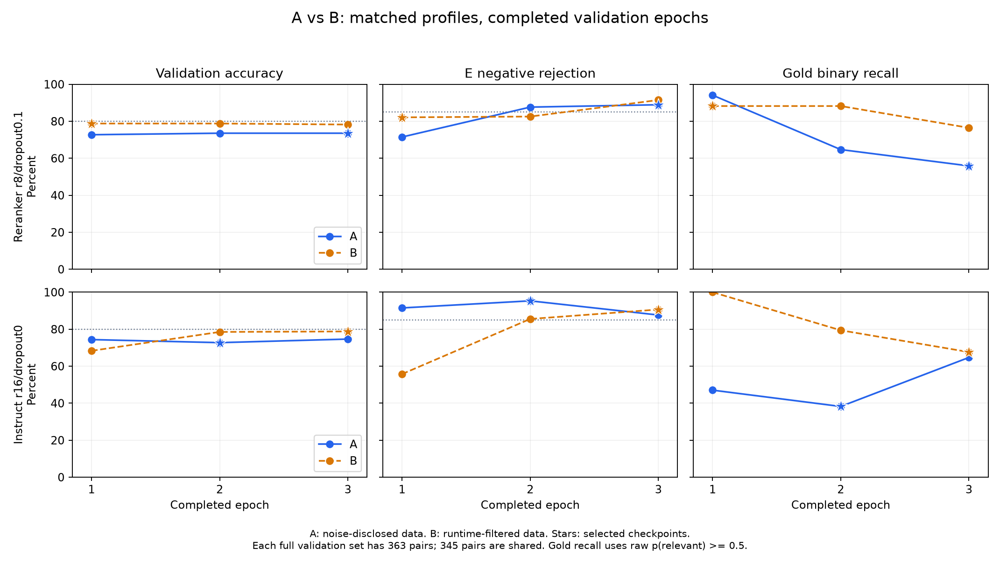

# v5 exploratory 双线实验总览

**最新状态（2026-10-15）**：C双底座已完成，完整VAL714仍未满足accuracy≥80%且AUC≥0.85；test和全量定位未启动。报告汇总兼容错误已修复。[C最终阶段报告](实验报告_v5_C融合扩挖_总览.md)。下方保留A/B及逐阶段历史，末节为C终态。

更新时间：2026-10-14T18:08:49.619892+08:00。仓库：旧版CoSIL；题集：同一SWE-bench Lite 300个issue。当前执行依据为**2026-10-14用户最新判读修正：E噪声披露双线继续；reranker 的23.93pp train-val差判过拟合，保留原结果并执行rank8/dropout0.1处方；处方后val<0.80则Verified扩挖与B覆盖过滤合并**。此前D2止损报告已保存为[历史归档](/mnt/skygruop0/home/wdt/cosil_repro/CoSIL/docs/v5-pruner/实验报告_v5_D2历史止损_总览.md)。历史失败签注保留，当前数据线继续。

| 工作项 | 当前落盘状态 |
|---|---|
| v3最终逐条审阅 | 30/30完成，确认3条错误；历史≤2门失败，已签结论 |
| v1/v2八例专项归档 | 已完成3＋5个案例，含JSON、CSV、证据链与哈希 |
| A线派生数据 | 派生数据已冻结并独立核对；精确删除3个train错误，val/test字节不变 |
| A线双底座训练／体检 | 持久训练状态：complete；实际启动模型数2；独立处方状态：complete |
| B线失败测试覆盖 | 正式缓存300/300；双证据合格133；其余失败／不完整保留纯静态标记 |
| 封存test／金丝雀定位／全量新定位 | 仅train/val训练体检；test、定位金丝雀与全量新定位尚未执行 |

## 当前政策、签注与数据版本

原v3保持字节不变，包括标签、统计、切分和封存test。30条证据审阅签注及[独立签结论](/mnt/skygruop0/home/wdt/cosil_repro/CoSIL/results/v5_pruner/v3_review_final_signoff.json)记录3条错误，各E族10条样本中各1条。审阅者为“Codex/机械证据审阅”，不是冒用真人签名。最新授权改变后续启动政策，不把旧签注或原statistics.passed改成通过。

8,000正例数量门改判为“待exploratory重定标”；原1,542的数量不足本身不阻止当前A线。E类标签质量改为披露抽检噪声与删除已确认train错误；机械标签来源、完整30条审阅、固定切分、去重、泄漏、原数据保护与test封存仍是严格条件。新协议和历史协议快照见[执行契约](/mnt/skygruop0/home/wdt/cosil_repro/CoSIL/results/v5_pruner/execution_contract.json)，当前状态见[执行记录](/mnt/skygruop0/home/wdt/cosil_repro/CoSIL/results/v5_pruner/data_problem_resolution_followup.json)。

| 原版本 | 独立正例 | 负例 | E并集 | 分层抽检错误 | 历史审阅结论 |
|---|---:|---:|---:|---:|---|
| v1 | 1,542 | 3,084 | 3,000 | 3/30 | 历史≤2门未通过 |
| v2 | 1,542 | 3,084 | 3,000 | 5/30 | 历史≤2门未通过 |
| v3 | 1,542 | 3,084 | 3,000 | 3/30 | 历史≤2门未通过 |

报告标注：**E类估计噪声约10%（三族各10条的分层抽检3/30）**。用户将三轮结果提出为静态证据实测地板的解释，现有证据不足以证明收敛或不可降低的噪声地板：每轮候选与抽检样本不同，且每族固定10条不按实际占比加权，3/30也不等于总体负例错误率。删除已确认3条后，不把27条剩余样本的零已知错误当作重新随机抽检通过。A/B 模型验证结果见下文；定位管线的实际影响仍待符合资格后的端到端评测。

### A线：剔除已确认训练错误后的exploratory训练

仅从独立派生train删除以下三条，不翻转标签、不补造替代负例、不改变val/test字节：

| issue | 删除函数 | 原E族 |
|---|---|---|
| django__django-12983 | django/template/defaultfilters.py::slugify@212 | e_anchor |
| django__django-14238 | django/db/models/base.py::ModelBase.__new__@74 | e_log |
| scikit-learn__scikit-learn-14983 | sklearn/model_selection/tests/test_split.py::test_cross_validator_with_default_params@130 | e_bm25 |

派生统计已落盘：正例1,542、负例3,081、E并集2,997。

| 数据 | 正例 | 负例 | E并集 | train行 | val行 | test行 |
|---|---:|---:|---:|---:|---:|---:|
| 原v3冻结版本 | 1,542 | 3,084 | 3,000 | 3,924 | 363 | 339 |
| A授权派生计数 | 1,542 | 3,081 | 2,997 | 3,921 | 363 | 339 |

E从3,000减为2,997是用户要求删除三个E训练错样的直接结果，作为精确三条的专项授权记录，不泛化为E数量门豁免。底座为Qwen3-Reranker-0.6B与Qwen2.5-0.5B-Instruct，同数据、LoRA rank16、lr5e-5、3 epoch、原批量与截断配置；只看train/val。train accuracy必须由eval模式真实预测计算，不能用训练loss代替。

原(a)/(b)/(c)是历史操作规则。最新用户裁定明确将 reranker train99.41%−val75.48%=23.93pp 判为过拟合，取消原(b)的val<0.70窄限制。先取原3轮val accuracy峰值；峰值为epoch3，与原best相同，早停选权重不能再提高现有成绩。随后同数据独立重训一次rank8＋dropout0.1，其余配置保持，alpha32不变（alpha/r从2变4，作为同时变化披露）。赛马以处方后的reranker与原instruct结算，仍要求val accuracy≥0.80、AUC≥0.85，再按E剔除率与原2pp规则决胜。处方后val仍<0.80即触发Verified与B双证据合并扩挖，不再等待train<0.70。探索性阶段不开test。[处方独立冻结协议](/mnt/skygruop0/home/wdt/cosil_repro/CoSIL/results/v5_pruner/A_regularized_execution_contract.json)保留原A协议不变。

- [实验报告_v5_A线_v3噪声披露exploratory.md](/mnt/skygruop0/home/wdt/cosil_repro/CoSIL/docs/v5-pruner/实验报告_v5_A线_v3噪声披露exploratory.md)
- [实验报告_v5_A线_rank8_dropout01正则处方.md](/mnt/skygruop0/home/wdt/cosil_repro/CoSIL/docs/v5-pruner/实验报告_v5_A线_rank8_dropout01正则处方.md)

| 底座 | 结果阶段 | train accuracy | val accuracy | val AUC | val E正确剔除率 | val混合集剔除precision |
|---|---|---:|---:|---:|---:|---:|
| reranker | best epoch 3，完整A结果 | 99.41% | 75.48% | 0.83287 | 90.64% | 77.03% |
| instruct | best epoch 2，完整A结果 | 93.88% | 72.73% | 0.84755 | 95.32% | 72.70% |
| reranker处方 rank8/dropout0.1 | val峰值epoch 3 | 99.36% | 73.55% | 0.82542 | 88.94% | 76.26% |

阶段val来自已完成epoch的真实预测，尚不代表双底座赛马最终结论；完整A结果才用同一best checkpoint的train与val判读。混合集剔除precision为TN/(TN+FN)，E正确剔除率为TN/(TN+FP)。表中无test或定位准确率。

图中点线为accuracy80%与E剔除85%参考线；gold曲线为灰区之前的0.5二分类召回，三项指标分别解释。处方曲线只包含已完成轮次，尚未完成的轮次不补点；[作图数据与SHA](/mnt/skygruop0/home/wdt/cosil_repro/CoSIL/results/v5_pruner/AB_final_report_coordinator_v3/final_snapshot/figures/A_validation_learning_curves_sources.json)。

上表原rank16 reranker 标记 **pre-regularization**，不再按旧report中的intermediate判读执行；处方训练成绩单独落盘，原预测和checkpoint不覆盖。

处方完成，选中epoch3（第2/3轮accuracy并列，以AUC选择第3轮）：train99.36%、val73.55%，差25.81个百分点；AUC0.825422、E正确剔除88.94%，赛马无合格赢家。相比原75.48%，处方没有提高val accuracy。[处方完整报告](/mnt/skygruop0/home/wdt/cosil_repro/CoSIL/docs/v5-pruner/实验报告_v5_A线_rank8_dropout01正则处方.md)。

按用户最新裁定，已用官方500题真实patch改动行与AST重生权威OOD身份：剔除Lite交集93题后，407题划为221题保留与186题可挖矿。186题静态五产线挖矿与独立CPU运行时覆盖均已实际启动；融合数据、审阅及扩后训练尚在后续阶段。当前A/B只比较Lite独立训练结果。[实际分支收据](/mnt/skygruop0/home/wdt/cosil_repro/CoSIL/results/v5_pruner/A_branch_processing_receipt.json)。

### gold 保留与分层口径

原 reranker 的 gold 保留率 **20/34=58.82%** 是未校准 p≥0.5 的二分类召回，发生在灰区划分前；不是高置信直判或灰区 Qwen 后的最终召回。

| 口径（均为 val 诊断） | low/high | gold直判保留 | gold直判剪除 | gold灰区 | 全体灰区 | E直判剔除 |
|---|---|---:|---:|---:|---:|---:|
| 未校准＋默认阈值 | 0.60/0.90 | 15/34 (44.12%) | 14/34 (41.18%) | 5/34 (14.71%) | 6.06% | 91.91% |
| val温度校准＋默认阈值 | 0.60/0.90 | 0/34 (0.00%) | 18/34 (52.94%) | 16/34 (47.06%) | 15.98% | 94.89% |
| val温度校准＋安全阈值诊断 | 0.10/0.90 | 0/34 (0.00%) | 0/34 (0.00%) | 34/34 (100.00%) | 90.36% | 14.47% |

安全阈值的零直剪仅是同一 val 上拟合的结果；整体灰区90.36%、E直剪14.47%，尚不能证明替代成本目标。未运行灰区 Qwen、未部署阈值、未打开 test。[逐条gold概率、校准与三分路由收据](/mnt/skygruop0/home/wdt/cosil_repro/CoSIL/results/v5_pruner/A_pre_regularization_reranker_gold_routes_exploratory/gold_route_report.md)。

原 instruct 的既定E-best为epoch2，二分类gold召回为13/34=38.24%，同口径三分如下。其accuracy峰值epoch3另作诊断，未改原best或赛马条件。

| instruct口径（均为val诊断） | low/high | gold直判保留 | gold直判剪除 | gold灰区 | 全体灰区 | E直判剔除 |
|---|---|---:|---:|---:|---:|---:|
| 未校准＋默认阈值 | 0.60/0.90 | 0/34 (0.00%) | 28/34 (82.35%) | 6/34 (17.65%) | 6.89% | 99.15% |
| val温度校准＋默认阈值 | 0.60/0.90 | 0/34 (0.00%) | 33/34 (97.06%) | 1/34 (2.94%) | 4.41% | 99.57% |
| val温度校准＋安全阈值诊断 | 0.20/0.90 | 0/34 (0.00%) | 0/34 (0.00%) | 34/34 (100.00%) | 53.99% | 66.81% |

[instruct逐条gold与校准收据](/mnt/skygruop0/home/wdt/cosil_repro/CoSIL/results/v5_pruner/A_original_instruct_best_gold_routes_exploratory/gold_route_report.md)。

处方reranker的最终峰值权重，采用同一定义报告：

| 处方口径（均为val诊断） | low/high | gold直判保留 | gold直判剪除 | gold灰区 | 全体灰区 | E直判剔除 |
|---|---|---:|---:|---:|---:|---:|
| 未校准＋默认阈值 | 0.60/0.90 | 17/34 (50.00%) | 15/34 (44.12%) | 2/34 (5.88%) | 4.13% | 89.36% |
| val校准＋默认阈值 | 0.60/0.90 | 0/34 (0.00%) | 17/34 (50.00%) | 17/34 (50.00%) | 18.18% | 91.91% |
| val校准＋安全阈值诊断 | 0.10/0.90 | 0/34 (0.00%) | 0/34 (0.00%) | 34/34 (100.00%) | 82.64% | 26.38% |

[处方逐条gold概率与路由收据](/mnt/skygruop0/home/wdt/cosil_repro/CoSIL/results/v5_pruner/A_post_regularization_peak_gold_routes_exploratory/gold_route_report.md)。安全阈值仍使全部34个gold进入灰区，零直剪仅是拟合val的结果；未调用Qwen或发布管线阈值。

这里的p始终为P(相关)，不是对任意verdict的置信度。默认low=0.6会直剪P(相关)接近0.6的候选，不能称为90%置信“不相关”。val温度校准不改变0.5二分类阈值下的判决；它校正概率尺度，安全分层还需另选阈值，不能把校准当作提高分类accuracy。

### B线：逐题base commit失败测试函数覆盖

对固定Lite300按各自FAIL_TO_PASS元信息执行，在隔离源码与环境中记录真实函数执行覆盖。每题结果永久缓存，成功、失败、环境／collection问题、测试未真正失败、覆盖不完整分别标记；不反复重跑已完成且指纹一致的结果。先核对跨项目金丝雀，再进行有界CPU并发的持久执行。

新负例资格为**原v3静态保守过滤合格，且不在该题经验证的失败测试函数覆盖集**。跑不通或覆盖不合格的题保持纯静态资格，逐行显式标记，不能混称为运行时证实“干净”。测试执行覆盖包含设置与辅助代码，执行过不等于致因；未覆盖也不能证明无关。覆盖过滤版保留这些证据边界。

完成后生成独立B数据版本、重新抽取30条train E审阅、同配置重训。对照表应并排给出A/B的train与val accuracy、AUC、E正确剔除率与混合集剔除precision，另在两版共同val函数pair上对照，避免将样本组成变化误称模型单独改善。A结果先落盘先报告，不等待B。

修后B原始数据已经生成：正例1,542、负例3,084、E并集3,000。实际签注0/30，审阅不安全负例数None（None表示尚未完成，不是零错误）。 审阅后精准删错派生数据：正例1,542、负例3,076、E并集2,992。 新审阅8/30是保守不安全率，包含7条明确源码关系和1条条件性AST visitor风险，不把8条都称为已证实该issue实际执行的标签错误。抽样中10条运行覆盖合格、20条纯静态，不安全分别1/10与7/20；不是总体噪声率或A/B因果改善证据。删除8条后剩余22条不称为重新随机抽检通过。

证据构建修复已归档：旧采集器只列补丁before目标，漏列补丁新增行映射到base既存函数的gold。独立完整gold核验仍保留133个原合格case，不升级原167个不合格case。修前B审阅包完整保留，修后包补齐gold源码；不改静态过滤规则、标签或原缓存。[独立完整gold覆盖审计](/mnt/skygruop0/home/wdt/cosil_repro/CoSIL/results/v5_pruner/runtime_coverage/full_existing_gold_eligibility_upgrade_audit.json)。

B仅进行原Lite300的独立覆盖过滤对照，尚非Verified融合扩挖。实际配置按底座匹配A：reranker rank8/dropout0.1/alpha32与val accuracy峰值，instruct rank16/dropout0/alpha32与原E-best；其余参数相同。B数据中的实际val共363对，与A有345个输入和标签相同的pair，最终分别报全val和共同pair，不能按行号或模型配置不一致来声称纯数据改善。

| B底座 | 当前真实阶段 | train accuracy | val accuracy | val AUC | E正确剔除率 | 0.5二分类gold召回 | 混合集剔除precision |
|---|---|---:|---:|---:|---:|---:|---:|
| reranker | best epoch 1，单底座完成 | 95.15% | 78.79% | 0.87762 | 82.13% | 88.24% | 86.34% |
| instruct | best epoch 3，单底座完成 | 99.00% | 78.79% | 0.86678 | 90.64% | 67.65% | 80.67% |

完整val与共同345个输入、标签相同pair的同底座对照见[A/B噪声披露与覆盖过滤对照](/mnt/skygruop0/home/wdt/cosil_repro/CoSIL/docs/v5-pruner/实验报告_v5_A-B_噪声披露与覆盖过滤对照.md)。该对照采用处方A reranker与B reranker相同rank8/dropout0.1，原A instruct与B instruct相同rank16/dropout0；采用真实保存概率重算，并按issue簇重采样区间。共同val改善仍是exploratory观测，不能据此证明噪声过滤的因果收益或端到端定位提升。

Verified扩挖与B融合采用2026-10-14用户授权的新权威规则：官方500题减Lite交集93题，407题逐题在真实base commit上提取patch改动行＋AST函数金标，issue全文忽略大小写包含任一金标限定名或def简单名者可挖矿；没有名称命中者保留OOD。实际保留221题，可挖矿186题；221题中13题无函数金标，未来函数评测标NA、分母208。旧文件名verified231_manifest.json保留，但数量允许变化。历史231池没有原脚本，不能声称恢复它，也不能编造差10题的定量成因。[最新用户裁定与执行](/mnt/skygruop0/home/wdt/cosil_repro/CoSIL/docs/v5-pruner/Verified231权威清单重生成_用户裁定与执行.md)、[权威逐题清单](/mnt/skygruop0/home/wdt/cosil_repro/CoSIL/results/v5_pruner/verified_regenerated_ood/verified231_manifest.json)。

官方Verified完整500条元数据按固定revision下载，93条Lite共享题的repo/base/issue/patch/test_patch/FAIL_TO_PASS等字段逐项一致。全部407题已完成独立真实Git源码／patch／AST核证，529个Python文件的1058份before/after档案可追溯。186题的A/C/D/e_bm25/e_anchor静态挖矿与独立CPU两worker运行时覆盖均已实际启动，旧Lite切分、test封存及原A/B数据不变。运行失败／selector不支持／函数未进入的题按证据回退纯静态并单列；coverage缺失不能证明因果无关，修改过的测试源码候选也不能靠缺覆盖升级。融合数据需另行重审和授权训练，当前未产生扩后模型指标或正式OOD成绩。[覆盖金丝雀、正式授权与边界](/mnt/skygruop0/home/wdt/cosil_repro/CoSIL/docs/v5-pruner/Verified运行时覆盖_金丝雀与执行边界.md)。

## 局限性与历史实证材料

原v3负例的E占97.28%，D-only84条占2.72%；带D来源的228条含与E重叠，不能全部计为D-only。原primary三族为e_log161、e_bm25 1,390、e_anchor 1,449，来自历史Qwen=True判决、文本相似和名称锚点，具有选择偏差，不能代表真实函数候选总体。原test的e_log只有9条，这个计数来自既有封存统计，未解码test样本或评测模型。

模型输入仅issue前2,000字符和候选函数前1,500字符。完整调用图中C正例的显式关系在候选输入中的可见性不同：train521/1,053、val71/87缺乏完整显式调用证据，可能位于未提供的gold源码或截断后。这是信息与分布限制，不直接证明标签错误。

前两版八例结构化档案见[E类漏过滤专项归档](/mnt/skygruop0/home/wdt/cosil_repro/CoSIL/docs/v5-pruner/E类漏过滤案例_v1-v2_专项归档.md)、[JSON](/mnt/skygruop0/home/wdt/cosil_repro/CoSIL/results/v5_pruner/e_filter_missed_cases_v1_v2.json)、[CSV](/mnt/skygruop0/home/wdt/cosil_repro/CoSIL/results/v5_pruner/e_filter_missed_cases_v1_v2.csv)。其中hist与ufuncify只证明源码可能祖先路径，不能说原issue已实际执行这些候选；八例都不新增金标或C正例。v3三条完整反例另见[反例档案](/mnt/skygruop0/home/wdt/cosil_repro/CoSIL/results/v5_pruner/data_v3/review_final_counterexamples.json)。

## 不变项与资源

Decision-1对线取消；不调用新付费API；不重跑300题Qwen基线。历史CoSIL/off的111/293=37.88%仅作既有定位基线，没有新模型定位准确率时不往结果矩阵写预测列。不动vLLM、CSRSE或他人进程；A/B训练仅在核实GPU2自然空闲后按单卡执行，GPU3保留给其他任务；B覆盖采集和新Verified覆盖采集使用有界CPU。GPU进程检查覆盖C+G，防止漏计仿真占用。

- [v3最终历史失败签注与局限性](/mnt/skygruop0/home/wdt/cosil_repro/CoSIL/docs/v5-pruner/数据重构_v3与质量门.md)
- [方案偏差与最新执行决定](/mnt/skygruop0/home/wdt/cosil_repro/CoSIL/docs/v5-pruner/方案偏差与执行决定.md)
- [执行进度](/mnt/skygruop0/home/wdt/cosil_repro/CoSIL/docs/v5-pruner/执行进度.md)
- [B线覆盖记录](/mnt/skygruop0/home/wdt/cosil_repro/CoSIL/docs/v5-pruner/运行时覆盖_B线.md)
- [B新30条逐条审阅与签注](/mnt/skygruop0/home/wdt/cosil_repro/CoSIL/docs/v5-pruner/B运行覆盖过滤_30条逐条审阅与签注.md)
- [Verified官方输入与历史231池预检归档](/mnt/skygruop0/home/wdt/cosil_repro/CoSIL/docs/v5-pruner/Verified官方输入与历史231池_补充预检.md)
- [最新权威221题OOD清单裁定](/mnt/skygruop0/home/wdt/cosil_repro/CoSIL/docs/v5-pruner/Verified231权威清单重生成_用户裁定与执行.md)
- [300题历史数据审计](/mnt/skygruop0/home/wdt/cosil_repro/CoSIL/docs/v5-pruner/实验报告_v5_逐题数据审计.md)

所有新模型结论以已落盘真实预测和训练记录为准；未完成的阶段不能据准备代码、旧基线或CPU合成检查补写成绩。

B的三分路由诊断使用各底座实际best epoch保存的val概率，分别报告gold直留、直剪和灰区；未调用灰区Qwen，未部署阈值，不能作为新定位结果。

- [B reranker 实际best epoch三分路由](/mnt/skygruop0/home/wdt/cosil_repro/CoSIL/results/v5_pruner/AB_final_report_coordinator_v3/final_snapshot/B_reranker_GoldRoutes/gold_route_report.md)
- [B instruct 实际best epoch三分路由](/mnt/skygruop0/home/wdt/cosil_repro/CoSIL/results/v5_pruner/AB_final_report_coordinator_v3/final_snapshot/B_instruct_GoldRoutes/gold_route_report.md)

## A/B 完成后的独立复核与学习曲线

原 rank16 reranker 保留为 pre-regularization；匹配配置的比较使用 A 处方 rank8/dropout0.1 对 B rank8/dropout0.1，以及原 A instruct rank16/dropout0 对 B 同配置。两套 val 均为 363 对，按 issue/function/input/label 对齐后的共同样本为 345 对，包含全部 121 个正例和 224 个负例。

| 同模型、共同 val 对 | B−A accuracy | issue 聚类 bootstrap 95% 区间 |
|---|---:|---:|
| reranker（345 对） | +3.77pp | −4.81pp 至 +12.34pp |
| instruct（345 对） | +5.51pp | +0.62pp 至 +11.63pp |

reranker 区间包含 0，现有验证数据不足以确认稳定提升；instruct 的区间在本次验证抽样中为正，但选 epoch 和训练体检使用了这些 val，不能当作独立 test 或纯数据因果证明。B 的两底座完整 val accuracy 均为 286/363=78.79%，仍无合格赛马赢家。

四条曲线均为真实完成的 3 轮验证，星号标记各自实际选中权重；gold 曲线为灰区之前的 p≥0.5 二分类召回。完整 val 的负例成员有差异，图中走势不能替代共同 345 对比较。上方原三条 A 曲线保留用于处方前后回顾。[新图源码数据与 SHA](figures/AB_matched_validation_learning_curves_sources.json)。

B 的实际选中权重已分别进行同口径三分诊断：[reranker gold 直留／直剪／灰区](../../results/v5_pruner/AB_final_report_coordinator_v3/final_snapshot/B_reranker_GoldRoutes/gold_route_report.md)、[instruct gold 直留／直剪／灰区](../../results/v5_pruner/AB_final_report_coordinator_v3/final_snapshot/B_instruct_GoldRoutes/gold_route_report.md)。reranker 温度校准后，默认阈值仍直剪 4/34 gold；同一 val 拟合的安全阈值将其降为 0/34，但整体灰区为 56.47%。未运行灰区 Qwen，也未部署阈值或开箱 test。

[root 独立发表前审计](../../results/v5_pruner/AB_completed_root_publication_audit_v1.json)重算了实际 val 预测、同配置 adapter/manifest、共同 pair 和 2,000 次聚类 bootstrap，并核验 33 个 snapshot 本地链接及全部绑定文件。此前协调器字段适配和相对路径错误已在独立新版本修复，原失败、训练和预测字节保留。

新增 186 题的静态挖掘、运行覆盖及扩后 C 数据已完成，30 条实际来源绑定审阅和训练数据冻结已完成；C 模型训练待资源启动，尚无 C、OOD 或新定位成绩。

## Verified 运行时覆盖正式终态

186/186 题均已落盘并通过独立终审：88 题满足全部官方 FAIL_TO_PASS 真正失败于 call 阶段、完整 base gold 函数进入等运行时资格，98 题回退纯静态。缺少函数覆盖不能证明因果无关，符合资格的覆盖仅作为新增负例排除证据。输入库存中的无 base-existing 函数 gold 为 10 题；回退分类表按每题首要边界记 7 题，两个数字用途不同，不能据分类表改写输入库存。

回退的环境、导入、选择器、collection/startup、setup/teardown、gold 未进入及 timeout 等原因已单列：[正式终态及回退报告](Verified运行时覆盖_金丝雀与执行边界.md)、[首要边界逐题分类](../../results/v5_pruner/runtime_coverage_verified_v2/final_runtime_observation_classes.json)。实际终审错误为 0，原 3 道金丝雀结果和 trace 字节保留，自有运行时进程已退出；未重复测试、使用 GPU 或调用模型。

[独立二次复核](../../results/v5_pruner/C_runtime186_independent_root_support_audit.json)完成 938 项绑定检查，覆盖 186 个结果、189 份 trace、源码、授权与终态。这里的“终态通过”仅指运行时证据完整性，不代表 C 数据质量门、模型资格或正式 OOD 评测通过。静态终态、新 30 条实际来源审阅与独立数据冻结随后均已完成，见下节；模型效果尚待实际训练。

## C 扩展数据已冻结，模型训练待自然空闲 GPU

最终 C 数据为正例 4,950、负例 9,892，其中 E 类 5,047；TRAIN13,411、VAL714、封存 TEST717。原样合并与运行过滤的首次预构造 N/P=1.78747 未通过固定 1.8 下限，已保留失败记录；从旧 B 冻结池按原 seed 合法补入 1,052 条未选 D-only TRAIN 机械负例后构建 RAW，并精确删除新审阅发现的 8 条 TRAIN 风险负例（旧 Lite 6 条、新 Verified 2 条）。未删正例、借用 val/test 或改变 E 资格规则凑比例。旧 B 的 363 条 VAL 原始行字节及顺序完整保留，RAW 与审阅派生版的 VAL/TEST/split 字节一致。

30 条逐条审阅为 22 条有限证据保留、6 条确认源码关系、2 条条件风险；8/30=26.67% 是三族各 10 条的分层保守排除比例，不能当作总体噪声率或 8 条已证明根因。原正例 8,000 数量门仍标为待 exploratory 重定标，旧 ≤2 审阅门保持历史失败；其他数据质量与完整性门已过，仅按 exploratory 准入。[实际签注](C融合扩挖_30条逐条审阅与签注.md)、[最终 51 项独审](../../results/v5_pruner/C_final_reviewed_data_independent_audit.json)、[冻结数据决定](../../results/v5_pruner/C_Verified_plus_B_runtime_authorization_exploratory/root_exploratory_decision.json)。

双底座配置与处方后的 B 一致，完整 C 验证、旧 Lite 共同 363 对和新增 Verified 351 对将分别报告。需要单列来源分布：TRAIN 的 C 正例占 87.17%，VAL 为 68.07%；TRAIN 的 D-only 负例占 51.02%，VAL 为 26.05%。全局正负约 1:2 不能消除这个差异，整体分类准确率也不能代替 gold 保留或定位准确率。

最新用户允许 GPU0–3 且不要求预留空卡；仍不挤占其他用户，不停止既有 vLLM/CSRSE。21:00 完整 C/C+G 进程观察显示四卡均有任务。新资源脚本已独立审核并获root授权，可自动选择自然空闲卡，模型开始以实际训练状态为准；test、OOD 评测、灰区 Qwen 与新定位仍未执行。[资源裁定](../../results/v5_pruner/GPU0_allowed_user_resource_policy.json)。

## GPU 实际任务归属核验与新资源启动规则

2026-10-14 21:07–21:10 按 GPU PID 的 `/proc` UID、启动命令、父进程和多次完整 NVIDIA XML 核查；不按“显存非零”推断作业归属。当前资源记录如下，表示当时实测，不是持续实时状态：

| 卡 | 归属及实际证据 | 处理 |
|---|---|---|
| GPU0 | `wdt` 的既有 Qwen/vLLM 服务，Engine PID2565659、parent2564556，单独约22,502 MiB；另外有其他账户的仿真上下文 | 保护既有服务；当前未空闲 |
| GPU1 | NVIDIA 还报告 C PID1632241约802 MiB，但当时 `/proc` 中无法解析；另外有 `yejingyu` 仿真上下文 | 旧 C 归属未决，不冒认属于我们或他人；不停止或重置卡 |
| GPU2/3 | `yejingyu`（UID1002）的 `evaluate_grasp_hold.py`，实测进程分别声明 `--device cuda:2`、`cuda:3`；采样利用率分别出现44–52%和52–75% | 是其他账户的实际计算任务，等待自然释放 |

仿真进程也在其它卡建立 C+G 上下文，所以“存在上下文”与“该卡是它唯一主计算卡”需分开。单凭 `--device` 参数或一瞬间利用率为零，都不能证明其它上下文永不计算。此前将四卡都笼统描述为“有任务”缺少归属区分；我们的 A/B 训练已结束，检查时没有正在运行的 v5 Python 模型训练，C尚无模型成绩。[逐PID归属](../../results/v5_pruner/GPU_process_ownership_root_audit_followup.json)、[连续采样](../../results/v5_pruner/GPU_actual_compute_vs_context_observation.json)。

原固定GPU2/预留GPU3代码和历史决定保持。新资源执行包独立63项检查通过，数据、双底座配置、损失、选模、校准和test拒绝逻辑保持；root已冻结资源授权与完成B后的队列放行。未来可选GPU0–3，取消预留卡要求，启动前只核所选卡的完整上下文、显存和利用率；其它忙卡不阻挡一张真正空闲的卡。只暂停自身直接创建的训练child，保护所有peer/服务及已有完整checkpoint/日志；暂停不进入赛马/报表或隐式恢复。[63项资源独审](../../results/v5_pruner/C_resource_v2_independent_CPU_audit.json)、[资源授权](../../results/v5_pruner/C_dynamic_GPU_resource_authorization_v2.json)、[队列放行](../../results/v5_pruner/C_training_queue_release.json)。

已授权持久启动器等待自然空闲卡。编排启动、CPU准入检查和真实模型开始分别按状态记录判断，不把准备代码或队列放行写成训练完成。C数据细节见[C扩挖数据与质量门](C融合扩挖_数据与质量门.md)。

C 持久编排已真实启动：`v5-C-Verified-resources-v2`，首次 pair 状态为 `waiting_for_natural_gpu_idle`、模型 runs=[]，未加载权重、未分配GPU。空闲后自动执行相同配置双底座训练与val赛马/报告，test继续封存。[启动收据及初始状态](../../results/v5_pruner/C_resources_v2_training_launch_receipt.json)。

## 最新资源裁定：共用显存充足的卡继续运行

用户在归属核验后明确要求继续跑、允许与现有任务共用卡且不杀他人进程；该指示覆盖此前只用自然空闲卡及新进程出现后让出的执行规则。仅停止了我们自己尚未加载模型的 v2 等待 driver/pair，完整源码、授权、队列和等待记录保留。正在准备独立共享资源 v3，按真实显存余量选卡，不停止 peer/vLLM/CSRSE，不改训练数据、双底座配置、选模、校准或封存 test。共卡条件下的时长/延迟将明确标记，不与独占运行直接作性能因果比较。[最新用户裁定](../../results/v5_pruner/GPU_sharing_user_override_policy_v3.json)、[仅停止自身等待进程的收据](../../results/v5_pruner/C_resources_v2_wait_only_stop_user_sharing_override_receipt.json)。

共享入口已实际启动，C reranker在GPU1训练：21:42:07完成GPU权重加载，21:44:53第1轮100个优化步，累计loss0.543265。未等待或杀掉其他任务；此loss只用于训练进度，C最终验证指标、第二底座、赛马和B/C对照尚未完成，test封存。[真实开训收据](../../results/v5_pruner/C_resources_v3_actual_model_and_first_training_progress_receipt.json)。

## 2026-10-15 C阶段已完成：验证未过门

C双底座训练、选权重和赛马于01:58完成，两个底座正常退出；未产生合格赢家。

| 底座（best） | train accuracy | 完整VAL714 accuracy | VAL AUC | E正确剔除 | gold召回（p≥0.5） |
|---|---:|---:|---:|---:|---:|
| reranker（epoch2） | 98.75% | 77.87%（556/714） | 0.84635 | 88.92% | 48/76＝63.16% |
| instruct（epoch3） | 99.36% | 79.69%（569/714） | 0.82059 | 94.60% | 49/76＝64.47% |

同旧Lite363对，instruct accuracy从78.79%升到82.09%，但gold保留从67.65%降到61.76%；reranker accuracy降到76.31%。两模型配对bootstrap区间都跨0。全714既定门未过，不以事后子集放行。test继续封存，未执行金丝雀/全量定位/追加矩阵；表中是相关性分类准确率。

自动汇总的v3队列字段兼容错误已在独立CPU报告版本修复，原失败和训练预测保留，未重训或改阈值。[C最终阶段报告](实验报告_v5_C融合扩挖_总览.md)、[B/C同口径报告](../../results/v5_pruner/B_C_resources_v3_completed_comparison_recovered_exploratory/B-C扩后验证对照.md)。
