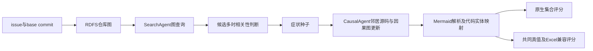

# GraphLocator + Qwen2.5-Coder-7B-Instruct：SWE-bench Lite 300 题总览

300 题全部已尝试：260 题流程完成，40 题失败（上下文超限 35、分词计数请求超时 5）。成功题中，164 题所有原生定位均为空，12 题仅有文件预测；兼容函数/类实体为空的合计 176 题。所有 300 题均有独立状态记录。

## 定位结果与口径

| 对齐指标 | Top-1 | Top-3 | Top-5 |
|---|---:|---:|---:|
| 文件（300题） | 43/300（14.33%） | 54/300（18.00%） | 55/300（18.33%） |
| 函数（共同真值） | 15/293（5.12%） | 24/293（8.19%） | 25/293（8.53%） |

对齐评分直接调用 CoSIL 表格维护脚本：文件 + 函数末段名称匹配，类/变量占实体位置，按已有 Top-k 去重口径；失败计未命中，无函数真值计 NA。函数重载/同名方法依旧存在该共同评分口径的区分限制。GraphLocator 原生输出是集合，作者代码没有候选置信度排名；本表 Top-k 使用原生因果图遍历转实体后、按文件分组的记录顺序，属于兼容比较，不能称为论文原生 Top-k。

| 原生层级 | 有真值题数 | 宏平均 Precision | 宏平均 Recall | 宏平均 F1 | 全部目标覆盖 SuccLoc | 至少一目标命中 |
|---|---:|---:|---:|---:|---:|---:|
| found_files | 300 | 13.76% | 18.67% | 14.92% | 18.67% | 18.67% |
| found_modules | 225 | 10.37% | 13.11% | 11.10% | 12.89% | 13.33% |
| found_functions | 277 | 5.43% | 8.66% | 6.10% | 8.66% | 8.66% |

原生指标按仓库自带 3 层级真值逐题去重并宏平均，SuccLoc 要求覆盖该题全部目标；不等于至少命中一个目标。原生函数真值与共同真值的适用题数不同，不能混用分母。 离线真值核验发现 47 题的函数目标集合不同（含适用题数差异）；其中 pytest-5413、pytest-5692 的作者函数真值使用单冒号且无仓库前缀，与其输出转换器的路径::函数格式不一致。原生评分逐字保留这些目标，不静默修正；共同评分另用已验证真值。详见 [真值差异审计](../../deployment/gold_alignment_audit.json)。

## 与历史 CoSIL 对照

| 实验列 | 函数 Top-1 | Top-3 | Top-5 |
|---|---:|---:|---:|
| CoSIL/on | 80/293（27.30%） | 103/293（35.15%） | 106/293（36.18%） |
| CoSIL/off | 75/293（25.60%） | 105/293（35.84%） | 111/293（37.88%） |
| GraphLocator/Qwen | 15/293（5.12%） | 24/293（8.19%） | 25/293（8.53%） |

框架、候选生成和输入源码范围均不同，这是同题同模型的复现对照，不能把差异归因于某个单独组件。单次温度 0 运行不能估计跨种子稳定性；多 GPU 的种子、权重和服务配置固定，额外保留副本一致性验证。

与 CoSIL/on 配对 Top-5：GraphLocator 独有命中 7，CoSIL 独有命中 88，共同命中 18，共同未命中 180；双侧精确 McNemar p=6.04859e-19。
与 CoSIL/off 配对 Top-5：GraphLocator 独有命中 8，CoSIL 独有命中 94，共同命中 17，共同未命中 174；双侧精确 McNemar p=9.43463e-20。

## 源码与因果图审计

输出定位但工具未提取任何节点源码：15；主搜索模型实际请求没有节点源码：22；主搜索及相关性判别都没有节点源码：15；因果模型没有节点源码：1。这里源码可含类头/变量赋值，下方再单独检查完整函数体。

输出定位但工具未获取函数体：40 题；主搜索模型实际请求未收到函数体：52 题；因果 agent 候选未收到函数体：3 题。最后一轮工具返回可能写入 messages 但没有下一次主搜索模型调用，因此按真实请求核验。工具反馈写入但主模型未再次收到的题数 5；主搜索与相关性模型都未收到函数体仍输出 42。 只统计函数体，不把类定义头、文件名、变量节点算作函数源码；因而不能把这些计数直接称作模型完全没有任何代码。

初始因果图解析为空 3 题；初始回答包含提示词中预置的示例因子名称 264 题；无效或越界代码元素编号 1718 次；最终无代码关联因子总计 947。这些为日志观察，不足以单独证明因果关系。

生成和解析分开记录：模型文字可能描述了函数，但只有满足作者 Mermaid 行格式的因子和有效的 1-based Code Elements 编号才能进入定位；旧因子代码关联沿用原实现，既有因子不能直接通过新编号重绑定；初始解析为空时队列为空，推理立即结束。

候选覆盖统计（共同函数真值）：

最终不限位置至少命中一个目标：25/293；种子包含目标：21/293；因果候选输入出现目标：44/293。具体覆盖丢失位置逐题记录，真值仅用于离线审计，从未加入模型提示词。

## 请求与运行成本

输入 token 合计 11,191,416，输出 1,572,690；最长已提交输入 61,906；达到输出长度预算 56 次；超出剩余上下文而下调输出预算 1 次。未裁剪 issue 或函数源码。

工具格式重试 550 次；无效工具查询反馈 170 次；记录的模型请求错误 0 次。各题耗时中位数 8.7 分钟；题级耗时总和 58.79 小时（并行执行，不等于墙钟）。模型请求耗时总和 37.64 小时。

## 按项目分布

| 项目 | 题数 | 函数适用 | 函数 Top-5 | 失败 |
|---|---:|---:|---:|---:|
| astropy/astropy | 6 | 6 | 0/6（0.00%） | 0 |
| django/django | 114 | 110 | 4/110（3.64%） | 14 |
| matplotlib/matplotlib | 23 | 23 | 1/23（4.35%） | 4 |
| mwaskom/seaborn | 4 | 4 | 0/4（0.00%） | 0 |
| pallets/flask | 3 | 3 | 1/3（33.33%） | 0 |
| psf/requests | 6 | 6 | 1/6（16.67%） | 0 |
| pydata/xarray | 5 | 5 | 0/5（0.00%） | 1 |
| pylint-dev/pylint | 6 | 6 | 0/6（0.00%） | 0 |
| pytest-dev/pytest | 17 | 16 | 0/16（0.00%） | 1 |
| scikit-learn/scikit-learn | 23 | 23 | 6/23（26.09%） | 5 |
| sphinx-doc/sphinx | 16 | 16 | 2/16（12.50%） | 0 |
| sympy/sympy | 77 | 75 | 10/75（13.33%） | 15 |

## 复现配置、部署问题与证据

上游仓库：[oceaneLIU/GraphLocator](https://github.com/oceaneLIU/GraphLocator)，固定提交 `2bb137cd946f0d29521d2277d6e0f636314e49c0`。模型实际为本地 Qwen2.5-Coder-7B-Instruct；API 名称 `llama3` 仅为当前服务兼容别名。所有 SearchAgent / relevance / CausalAgent 调用均经 localhost，未调用 OpenAI 或 Anthropic 外部模型。

非流式请求等待 1800 秒；OpenAI/LiteLLM SDK 隐式重试设为 0，只有带记录的外层传输重试。金丝雀曾观察到 600 秒超时后 SDK 重新生成同一请求，已修复并重新验证。保留作者搜索 5 轮、top_k=5 和因果 max_turn=20 参数；作者条件 `turn > max_turn` 实际最多 21 次更新，报告记录实际次数。固定温度 0、seed 0、PYTHONHASHSEED 0；最大输出 8192，服务上下文 65536。种子集合和邻居集合保留作者实现，不通过真值调整检索或推理。

独立 Python 3.11 客户端环境兼容旧 tree-sitter 插件；README 建议 3.13，该差异及依赖锁、实际版本、GPU/模型启动参数均留档。模型服务环境保持原有 CoSIL 配置。

金丝雀发现新建 Location 路径为字符串而反序列化为 Path，节点显示相同却不相等，已统一路径类型；无效工具参数改为工具错误反馈并在原轮数内继续搜索，失败验证原样保留。修复作者返回值元组与 `.choices` 解析不一致、工具参数转码、工具响应历史顺序、空结果、路径前缀/实体序列化/节点哈希修改、空出边优先级和无效编号映射。查询执行改为已声明图工具的字面量 AST 调用；Qwen 若只输出工具 JSON 文字，允许一次原生调用格式修复，作为模型协议适配记账。依赖图只读阶段改为每进程绑定一次图，等价边比较和耗时留档。

[部署与修复说明](部署与复现记录.md) · [完整补丁](../../deployment/local_changes.patch) · [金丝雀准入](../../results/qwen_300/canary_gate.json) · [正式版本清单](../../results/qwen_300/full_manifest.json) · [机器可读指标](../../results/qwen_300/metrics.json) · [逐题分析](实验报告_GraphLocator_Qwen300_逐题分析.md)

正式实验与金丝雀结果分开存储；失败、空预测和 NA 分别保留。Excel 以 issue ID 追加 GraphLocator/Qwen 列，保留原有 CoSIL/on、CoSIL/off 历史预测。

## 进一步诊断

源码审计只计图查询及节点提供的仓库代码；issue 中的复现代码不计。文件/目录节点的 content 名称不计源码。主搜索、相关性判断、因果推理分开审计；主搜索没有函数体、因果模型后来收到函数体，不能称为整个定位过程没有源码。收到源码也不等于能证明模型认真理解了源码。

相关性判断共 209 次，其中 31 次列表长度不符合候选数，涉及 24 题；7 次没有可解析的闭合代码块；7 次耗尽输出预算；0 次包含非字面 True/False 的行。按作者规则，长度不等会拒绝这批候选，缺少闭合代码块也不会自动使用输出前缀。

包含内嵌星号（例如 `*parse_http_date*`）的查询涉及 40 题。作者工具只对参数值单独的 `*` 提供通配语义，内嵌星号进入名称模糊检索；短文件名、包名与函数名可能同时得到相同的零距离，结果还受图节点插入顺序影响。该计数是行为观察，不能单独证明这些题均因该原因失败。

因果候选出现过目标但最终完全没保留：19 题；目标存在于最终预测但排在 Top-5 之后：0 题。两种情况分开统计。

新增因子实际映射时的无效编号 1177 次；既有因子输出中、相对新候选列表越界的编号 539 次。后者沿用旧关联，并不重新索引；既有因子带非空编号、但未重新绑定的行共 1756 次。前文总越界编号是输出级检查，包含这些既有因子，不能全解释为新关联被拒绝。

兼容 Excel 导出先列原生函数，再列没有对应函数的模块/类；同文件实体分组，重复拥有函数的模块不重复占位。因此 Top-k 只用于既有表格兼容，原生集合指标与不限位置覆盖更适合描述 GraphLocator 原输出。

本轮在兼容修补后续跑：保留 48 题已完成预测和 6 题未受补丁影响的上下文失败；受字典边解析影响的 1 题另行重跑。新补丁仅兼容边数据表示，正常字符串解析回归结果完全一致。所有复用成功题的原始文件 SHA256 仍相同，旧版故障与版本清单完整保留；本轮使用了两个部署批次，不声称所有 Python 文件字节版本一致。详见 [兼容修补批次记录](../../results/qwen_300/compatible_edge_fix_lineage.json)。

[逐题补充诊断](../../results/qwen_300/additional_diagnostics.json)。上述分析全在预测冻结后进行，没有追加模型调用或修改历史预测。

## 结果解读与失败阶段

函数不限位置命中与 Top-5 均为 25/293（8.53%）；实际递交给因果模型的候选仅在 44/293 题覆盖目标，已覆盖却最终丢失的为 19 题。当前主要可观察问题在候选覆盖及代码关联；单次实验无法进一步区分各组件的独立因果贡献。该 Qwen 复现显著低于历史 CoSIL/on 的 36.18% 和 off 的 37.88%，不能把这些数值当作原论文使用其他模型的结果。

完成的 260 题中，199 题没有原生函数预测；160 题成功返回了零个搜索种子。还有 31 题在种子阶段完成前失败，种子状态标记为未完成，不当成已返回空种子。其余失败题的种子从事件恢复，因此目标种子覆盖修正为 21/293。此修正只涉及诊断，不修改预测、定位指标或 Excel。

269 题获得初始因果答复，其中 264 题出现提示词示例的因子标签（98.14%）。这一现象与空代码关联并存，支持后续进一步检验模板对小模型输出的影响，但不是因果证明。

上下文预检拒绝的最大输入为 8,583,347 token，超限失败 35 题。最长成功提交输入为 61,906 token；二者统计范围不同。分词端点等待 30 秒超时的为 5 题，其中 sympy-15609 已在同版本单次重试并保留原记录，仍超时。正式已返回响应累计约 1119 万输入、157 万输出 token；金丝雀、被中断的尝试及未返回的分词请求不含在该用量中。

300 个 issue ID、所有 Top-k Excel 单元格、作者原生指标、48 个复用文件哈希和原 CoSIL 两列均已独立核验：[核验记录](../../results/qwen_300/independent_verification.json)。

正式题首次开始于 2026-10-09 00:49:44，最后结束于 09:01:26，墙钟约 8 小时 11 分钟（包含兼容修补检查与续跑等待；部署准备和之前金丝雀另计）。临时 GPU1/2/3 服务已在结束后释放，原 GPU0/7333 服务保留。
