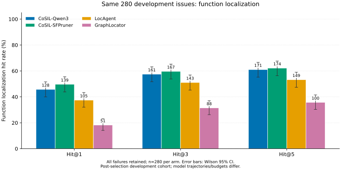

# GraphLocator＋Qwen3-8B：统一280题定位实验总览

全部**280题已结束，280份runner回执齐全**。GraphLocator的函数Hit@1/3/5为**51/280、88/280、100/280（18.21%、31.43%、35.71%）**；文件Hit@1/3/5为**112/280、162/280、166/280（40.00%、57.86%、59.29%）**。272题完成原流程，7题因上下文容量停止、1题达到单题时间上限，8个失败全部留在分母。

本次统一v3结果的函数Hit@5低于同题CoSIL-SFPruner的174/280（62.14%），差74题、26.43个百分点。结果说明当前通用Qwen3及固定协议下，这一GraphLocator实现仍有较多问题没有转成正确函数排名；具体应结合候选、图覆盖、源码证据与CIG输出审计判断，不能把这个数字当成原论文原模型的成绩。

直接查看：[逐题CSV（本地）](逐题结果_GraphLocator_Qwen3_280题.csv) · [定位失败报告：分类＋180题逐题](定位失败原因_GraphLocator_Qwen3_280题.md) · [完整自动报告](../../experiments/qwen3_rebench280_v3_20261116/reports/final_delivery/final_report.md) · [独立核验](独立核验_GraphLocator_Qwen3_280题.md) · [高清图PNG](figures/function_hit_280.png)。CSV及原始结果只在本地归档，不随代码公开上传。

## 同280题的四臂结果

| 范围 | 指标 | CoSIL-Qwen3 | CoSIL-SFPruner | LocAgent统一解析 | GraphLocator v3 |
|---|---|---:|---:|---:|---:|
| 文件 | Hit@1 | 157/280（56.07%；CI[50.21, 61.76]%） | 157/280（56.07%；CI[50.21, 61.76]%） | 171/280（61.07%；CI[55.25, 66.60]%） | 112/280（40.00%；CI[34.43, 45.84]%） |
| 文件 | Hit@3 | 203/280（72.50%；CI[66.99, 77.40]%） | 203/280（72.50%；CI[66.99, 77.40]%） | 199/280（71.07%；CI[65.50, 76.07]%） | 162/280（57.86%；CI[52.01, 63.50]%） |
| 文件 | Hit@5 | 217/280（77.50%；CI[72.26, 82.00]%） | 217/280（77.50%；CI[72.26, 82.00]%） | 206/280（73.57%；CI[68.11, 78.39]%） | 166/280（59.29%；CI[53.44, 64.88]%） |
| 函数 | Hit@1 | 128/280（45.71%；CI[39.98, 51.57]%） | 139/280（49.64%；CI[43.83, 55.46]%） | 105/280（37.50%；CI[32.03, 43.30]%） | 51/280（18.21%；CI[14.13, 23.16]%） |
| 函数 | Hit@3 | 161/280（57.50%；CI[51.65, 63.15]%） | 167/280（59.64%；CI[53.80, 65.22]%） | 143/280（51.07%；CI[45.24, 56.87]%） | 88/280（31.43%；CI[26.27, 37.09]%） |
| 函数 | Hit@5 | 171/280（61.07%；CI[55.25, 66.60]%） | 174/280（62.14%；CI[56.33, 67.62]%） | 149/280（53.21%；CI[47.37, 58.98]%） | 100/280（35.71%；CI[30.33, 41.49]%） |

表中Hit的95%CI为Wilson区间。四臂都按相同issue ID对齐，全部文件/函数可评价分母均为280；两个历史CoSIL运行失败也保留。三个历史臂只复用被冻结的原预测，不因本轮GraphLocator结果换版本。



图中柱高为命中率，柱上数字为命中题数，误差线为Wilson95%CI；所有失败均保留在n=280中。

| 范围 | 指标 | CoSIL-Qwen3 | CoSIL-SFPruner | LocAgent统一解析 | GraphLocator v3 |
|---|---|---:|---:|---:|---:|
| 文件 | Macro-P@5 | 15.50% | 15.50% | 14.71% | 11.86% |
| 文件 | Macro-R@5 | 77.50% | 77.50% | 73.57% | 59.29% |
| 文件 | Macro-F1@5 | 25.83% | 25.83% | 24.52% | 19.76% |
| 文件 | AllCoverage@5 | 77.50% | 77.50% | 73.57% | 59.29% |
| 文件 | MRR@10 | 0.6471 | 0.6471 | 0.6622 | 0.4876 |
| 函数 | Macro-P@5 | 14.00% | 14.14% | 11.93% | 7.57% |
| 函数 | Macro-R@5 | 57.30% | 57.89% | 49.09% | 33.26% |
| 函数 | Macro-F1@5 | 21.91% | 22.04% | 18.66% | 12.06% |
| 函数 | AllCoverage@5 | 53.93% | 53.93% | 45.36% | 31.07% |
| 函数 | MRR@10 | 0.5195 | 0.5464 | 0.4466 | 0.2567 |

函数Hit@5表示至少命中一个既有目标函数，AllCoverage@5表示全部既有目标都在前5；本轮GraphLocator分别为100/280和87/280。Macro-Recall先在每题计算目标函数召回，再对280题平均；P@5固定除以5，少报候选也不缩分母。排名按原生CIG因子与绑定插入顺序保留，严格以base库存中的`path::qualified_name`评分，不按Gold消歧、不展开类、不压缩无效或重复槽。

## 同题配对比较

| 函数Hit@5比较：GraphLocator−前者 | 均中/仅前者/仅GraphLocator/均未中 | 差值 | 配对95%CI | 精确McNemar p |
|---|---|---:|---:|---:|
| CoSIL-Qwen3 | 86/85/14/95 | -25.36pp | [-31.79, -18.93]pp | 1.42799e-13 |
| CoSIL-SFPruner | 86/88/14/92 | -26.43pp | [-32.86, -20.00]pp | 2.77539e-14 |
| LocAgent | 78/71/22/109 | -17.50pp | [-23.93, -11.07]pp | 3.48248e-07 |

差值区间采用同题bootstrap（seed20261115，5000次），完整Hit@1/3/5及文件配对表在自动报告。区间条件于这个固定开发池，不校正事后选样偏差；比较未作多重校正，统计差异也不消除轨迹预算差异，不能把不显著解释为等效。

## 执行状态与未命中

| 可观察阶段 | 题数 |
|---|---:|
| 文件Top5未命中；检索/选择/证据利用原因待查 | 80 |
| 函数Top5覆盖全部目标 | 87 |
| 文件Top5命中而函数Top5未命中；身份与判断原因待查 | 66 |
| 执行完成但没有有效候选；具体原因待日志 | 26 |
| 执行失败，无最终排名；不归因为模型一定不会定位 | 8 |
| 函数Top5部分目标命中 | 13 |

其中272个complete仅表示原定位流程走完，不能当成272题定位正确。7个`ContextBudgetExceeded`在精确计数后因65536容量不足而停止，不静默截代码；1个`runner_timeout`达到1800秒预算。它们保留此前真实usage、错误与空排名，不换题或额外生成救分。

对180道函数Top5未命中题，日志与离线图库存给出的互斥阶段分解为：120题图中有目标函数节点，但目标没有作为显式函数候选被召回；1题没有精确目标函数节点；3题目标候选被相关性过滤；36题目标已送达CIG阶段但没有进入最终绑定；12题已有目标但排在第5之后；8题是上述资源失败。**显式函数候选没有出现，不等于模型完全没有看到目标源码**，文件或类文本仍可能包含函数体，完整源码是否可见须看逐题证据。阶段也不等于唯一原因，不能从这张分类表直接断言模型不会工具或某一步是唯一瓶颈。

图库存总共366个既有目标，362个有精确函数节点；缺失4个均为嵌套函数。按题看，276题目标节点全有、3题部分有、1题全无。缺少独立节点不等于文件/类文本中没有函数体；这一小部分图覆盖限制不能单独解释180道Top5未命中，更应结合候选进入、过滤及CIG绑定的实际链路分析。证据见[图库存核验](图库存覆盖核验_GraphLocator_Qwen3_280题.md)和[180题逐题分析](定位失败原因_GraphLocator_Qwen3_280题.md)。

模型实际声明的1264次检索调用均完成执行，未发现未知工具名、参数JSON错误或工具异常；353次经过定长布尔相关性判断、909次按原算法小于top-k直接采用，另2次在相关性请求容量预检处停止。1064份过滤后的观测在后续搜索请求中核验一致，其余200份没有后续搜索请求，包含末轮结束和容量停止，不能当成工具结果丢失。工具调用成功、文本送达、函数完整可见与定位正确是不同事实；详见[工具使用审计](工具使用审计_GraphLocator_Qwen3_280题.md)。

3762份已完成回执的actual model均为`qwen3-8b`；其中34次`finish_reason=length`均为CIG请求达到8192输出上限，涉及24题（23题最终complete、1题runner超时）。因此complete也不代表每一步回复均未截断。这个标记说明单请求输出预算的影响，不自动判整题失败，也不足以认定唯一未命中原因；1次未结束请求继续保留usage未知。详见[模型与输出上限补充核验](模型回执与输出上限核验_GraphLocator_Qwen3_280题.md)。

## 耗时、token和费用

| GraphLocator统一280题 | 实测 |
|---|---:|
| 已知输入token下界 | 16,515,005 |
| 已知输出token下界 | 951,723 |
| 已知合计token下界 | **17,466,728** |
| usage未知的请求尝试 | **1**；精确全局总量为unknown |
| generation HTTP尝试 | 3,763 |
| 每题已知token下界：均值/中位/P90 | 62,381.17 / 41,296 / 139,867 |
| worker内部耗时：均值/中位/P90 | 132.78 / 72.25 / 334.28秒 |
| runner完整进程耗时：均值/中位/P90 | 134.22 / 73.74 / 335.67秒 |
| 新增付费API费用 | $0，本地模型服务；不代表硬件和电费为0 |

通常一道题的runner中位耗时约**74秒**，P90约**336秒**。从v3首个pilot controller启动到全280完成回执的实际跨度为20,572.55秒（约5.71小时），含两阶段间等待，不含此前模型启动、构图或v1/v2工程尝试。累计单题runner耗时37,581.67秒不能当成并行墙钟。

17,466,728是包含超时题已返回部分在内的**已知下界**，不能写成完整总token；未知1次不补零。只有279题的精确`total_tokens`合计17,298,281也不是280题总量。token均值/中位/P90以逐题已知下界计算，历史三个臂的资源不重新记为本轮新增，硬件与预算也不作严格等价速度比较。V1/V2试跑及独立smoke保留各自账本，不混入本表；v3采样smoke另有1次58token工程请求。

## 方法、版本与边界

- 数据由既有冻结280名单复用，含`nebius/SWE-rebench-leaderboard@34d5a58864acf91613740a09ec5d205228dcfa39`的95题和`nebius/SWE-rebench@89cdfbab4ab1bd8f5a658bb212d1b63624f4f881`的185题。沿用四项Lite式条件及隔离要求，不重新按本轮GraphLocator表现选题；这是定位评测，不是CQ2-CARE原论文300题或完整Lite协议复刻。
- 模型为通用`Qwen/Qwen3-8B@b968826d9c46dd6066d109eabc6255188de91218`，不是GraphLocator作者微调权重。显式非思考；temperature0.7/top_p0.8/top_k20/min_p0为固定revision官方非思考建议，request seed0是本实验固定项，不保证并发或后端绝对确定。
- GraphLocator单轨迹n1，原Search/Causal流程与CIG因子及插入顺序排名；HTTP600秒、单题1800秒、容量65536、单响应最多8192，输入不静默截断。Gold-blind通用兼容补丁包括相关性定长JSON、公开AST312身份对齐等，不冒称逐字官方复现。历史LocAgent为两个temperature1样本MRR融合；CoSIL等历史条件也有预算与实现差异，不把差值全部归给算法。
- v1/v2/v3工程原件都保留：v1出现布尔缺项、HTTP超时与上下文限制；v2在重复长生成风险后退休（4complete、1操作中断、15未启动，无整批准确率）；v3固定官方非思考profile。多个变化不是单因素消融，不将各版按题择优拼成成绩。本次先20题再260题执行，但主表统一同v3的280题，未假称一次连续无间断启动。
- **父280池来自既有300题结果的事后选择：去除了18道基线占优题和2道双方未命中题。** v1同20题历史成绩也已观察；本轮是带结果选择偏差的开发比较，不是新的独立盲测，不能据此推断未筛选总体优势。定位worker只见本题issue与base源码/公开图，不见参考补丁、Gold、历史预测或封存test。
- 只做定位，不训练、不生成补丁、不执行修复测试，不修改论文和历史矩阵。77项整套CPU测试、55冻结源码/grammar及HTTP实际参数已核验；独立验收128,085项检查0差异，全部280worker与runner齐后才读取全量Gold并评分。
- 实验结束后按uid/启动ticks/命令及pidfd核验，仅关闭自有模型服务；5个自有进程均已退出，7353端口关闭，未向他人任务发送信号。

## 交付与复现

独立纯CPU审计脚本、科学图工具和依赖说明见[分析与绘图复现入口](../../analysis/qwen3_rebench280/README.md)，它们不进入冻结推理guard，也不新增模型调用。

主入口为本页；本地[逐题CSV](逐题结果_GraphLocator_Qwen3_280题.csv)包含280个唯一issue ID及四臂结果。完整原件位于`experiments/qwen3_rebench280_v3_20261116/reports/final_delivery/`，不改写历史20题报告。运行方法见[v3说明](v3_运行与解码配置说明_20261116.md)，严格评价与区间见[自动报告](../../experiments/qwen3_rebench280_v3_20261116/reports/final_delivery/final_report.md)，独立来源核查见[独立验收](独立核验_GraphLocator_Qwen3_280题.md)。

```bash
source .venv/bin/activate
python -m rebench_qwen3.evaluate \
  --run experiments/qwen3_rebench280_v3_20261116 --scope full280 \
  --output experiments/qwen3_rebench280_v3_20261116/reports/NEW_FINAL_REPRODUCTION
```

新输出目录不得覆盖。评价不新增模型调用；名单、结果、Gold、库存和历史reference由SHA绑定，禁止更换分母或修正模型预测槽。协议SHA256为`4e60bd1e786f82d7877ce9b66a6c4c92ea5b160cd0ab26d7b59e6fb394d3d8a5`，冻结评价器SHA256为`22b6c4c8c24da8b88bc09c0191ffe830d5ba375183e1d98c00577007adffe5aa`。完整评价JSON SHA256为`368e98c9ad97a9585aad3b15afebc81ecc5f9220fd7e387834d8c39f31bd9e78`。

公开恢复点仅包含代码、合成测试、文档、派生汇总图与审核结论；CSV、完整JSON、原始请求响应/工具日志、Gold、模型、二进制、封存test及未发表论文均不上传。
